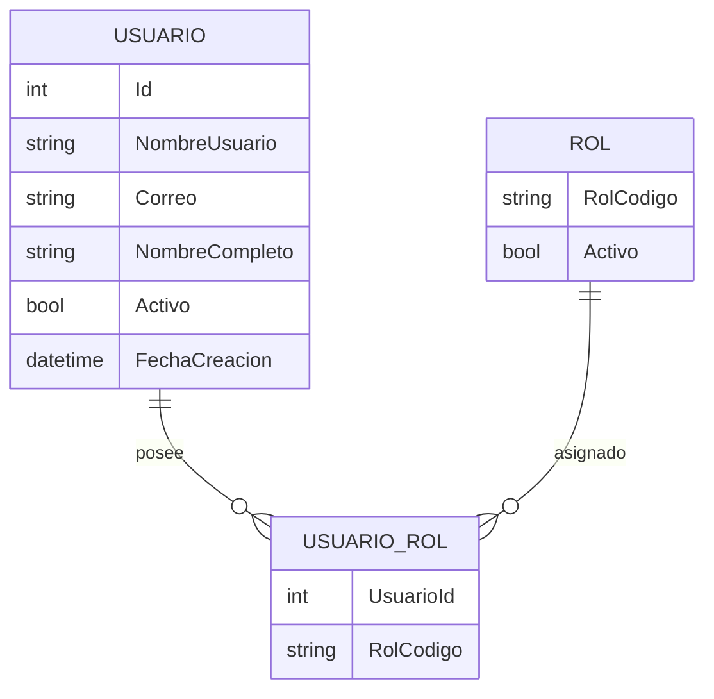

# Modelo de datos de seguridad — V3

Este documento refleja entidades **inferidas de clases y endpoints mostrados en el proyecto**; no declara un esquema SQL completo sin inspeccionar la base de datos. Los nombres físicos y relaciones reales deben contrastarse con scripts SQL locales.

## Usuario
Campos observables en la respuesta de registro: `Id`, `NombreUsuario`, `Correo`, `NombreCompleto`, `Activo`, `FechaCreacion`. La entidad de persistencia incluye información de hash de contraseña, **que nunca debe enviarse al cliente**.

## Rol
Código lógico del rol: `ADMIN`, `GESTOR`, `CONSULTA`; los roles pueden estar activos o inactivos según las comprobaciones del repositorio SQL.

## Asignación usuario–rol
Relación lógica de varios roles por usuario. Operaciones: asignar, retirar, consultar roles activos. Se protege el último administrador activo con reglas de negocio persistentes.

## Inicio de sesión
**Entrada:** nombreUsuario, contrasena.  
**Salida:** resultado de autenticación provisto por `ServicioAutenticacion`. El contrato exacto del DTO de salida requiere consultar el código local; se espera que el frontend pueda obtener un JWT y los datos de sesión necesarios.

## Estado de sesión del frontend
Campos utilizados en la implementación: `Token`, `Autenticado`, `NombreUsuario` y validación `TieneRol(...)`. Es estado de aplicación, **no tabla SQL**.

## Diagrama conceptual

## Reglas observadas
1. Los usuarios nuevos reciben CONSULTA como rol inicial.
2. Asignar GESTOR no implica quitar CONSULTA: se requiere acción separada.
3. El estado del usuario puede modificarse desde un endpoint ADMIN.
4. La base de datos impide retirar o desactivar al último administrador activo según códigos SQL manejados por el controlador.
5. Los datos de contraseña/hash no se incluyen en las proyecciones de respuesta.

## Pendiente de comprobar
DDL, índices únicos, FK, procedimientos y nombres físicos exactos; no modificar esquema por este documento.
