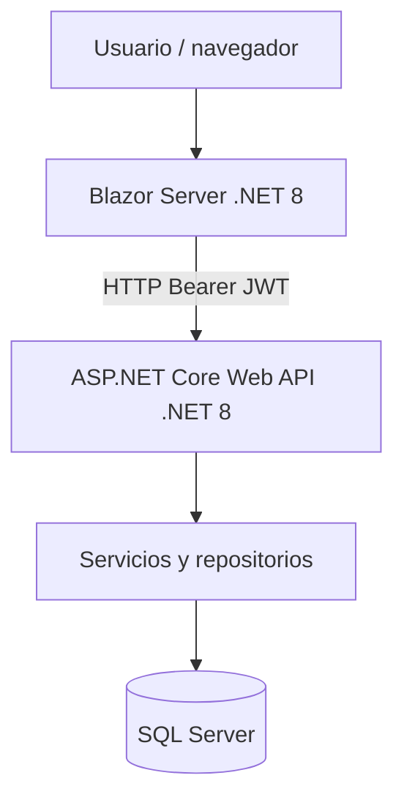

# Plan de implementación y estabilización — V3

**Feature:** `003-gestion-profesoral-v3`  
**Estado:** Plan de validación del desarrollo existente; no autoriza cambios destructivos.

## Arquitectura existente

## Componentes afectados
- API: `api_gestion/Controllers` y componentes JWT/autenticación/usuarios, sin duplicar rutas.
- Frontend: `front_blazor/Servicios/ServicioSesionJwt.cs`, servicios HttpClient y páginas de login/administración.
- Navegación: `front_blazor/Components/App.razor`, `Components/Layout/MainLayout.razor`, `Components/Routes.razor`.
- Configuración: `Program.cs`, variables de entorno y configuración de producción.
- Documentación: `specs/003-gestion-profesoral-v3/`, README y `.gitignore`.

## Fases
### Fase A — Congelar estado e inventariar
1. Registrar rama, `git status`, cambios locales, dependencias y versión SDK.
2. Copia de seguridad o commit de trabajo previo a modificaciones.
3. Comparar controladores presentes en el equipo con la rama remota: la lista local puede ser mayor.

### Fase B — Validar seguridad de API
1. Auditar atributos `[Authorize]` a nivel de clase y de método; `[AllowAnonymous]` explícito donde corresponda.
2. Verificar rol ADMIN en administración y registro de cuentas.
3. Revisar emisor, audiencia, firma, expiración y validación del JWT en API.
4. Probar sesión activa, rol vigente, usuarios desactivados y último ADMIN activo.
5. Asegurar 401/403 coherentes.

### Fase C — Validar frontend
1. Confirmar `ServicioSesionJwt` registrado como scoped y usado por login, layout y servicios.
2. Verificar modo interactivo de las rutas de Blazor.
3. Confirmar redirección a `/login` solo sin sesión; evitar bucles en prerender/navegación.
4. Verificar `CerrarSesion()` y el botón de logout.
5. Comprobar token Bearer por solicitud y mensajes de errores.

### Fase D — Pruebas de regresión
Compilar API y frontend, revisar pruebas de autenticación/autorización por rol y ejecutar smoke tests de Docente Maestro, catálogos y relaciones académicas.

### Fase E — Preparar repositorio y despliegue
1. Revisar secretos en `appsettings*`, `.env` y cambios staged.
2. Documentar variables requeridas sin valores confidenciales.
3. Compilar Release, revisar configuraciones de IIS/hosting/SignalR si aplica.
4. Preparar publicación API y Blazor por separado; **no desplegar en esta fase**.
5. Hacer commit y push solo después de revisión humana.

## Riesgos y mitigación
- **Doble circuito de Blazor:** diferentes instancias de sesión o renderizado estático pueden generar redirecciones inesperadas; verificar en navegador con login/logout.
- **Token no invalidado servidor:** logout local no revoca automáticamente un token ya emitido; vencimiento y validación de usuario siguen siendo necesarios.
- **Cambios locales fuera de GitHub:** no sobrescribir archivos sin inspeccionar la versión actual.
- **Confundir protección visual con API:** ocultar botones no sustituye autorización server-side.
- **Filtración de claves:** usar secretos/variables de entorno, nunca commit.

## Puertas de salida
- Build API y frontend exitoso.
- Matriz de roles y navegación probadas.
- No hay secretos o artefactos indebidos staged.
- README, documentación y cambios revisados.
